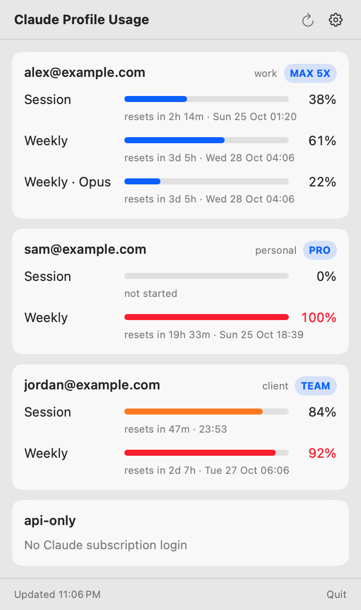
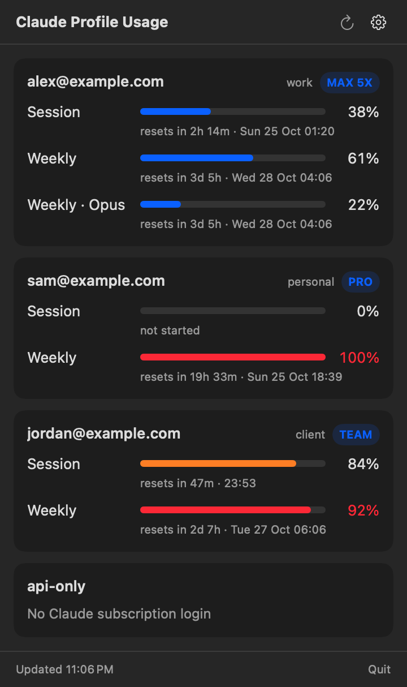
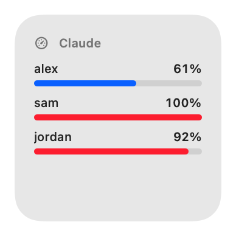
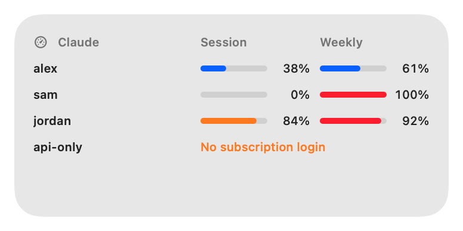
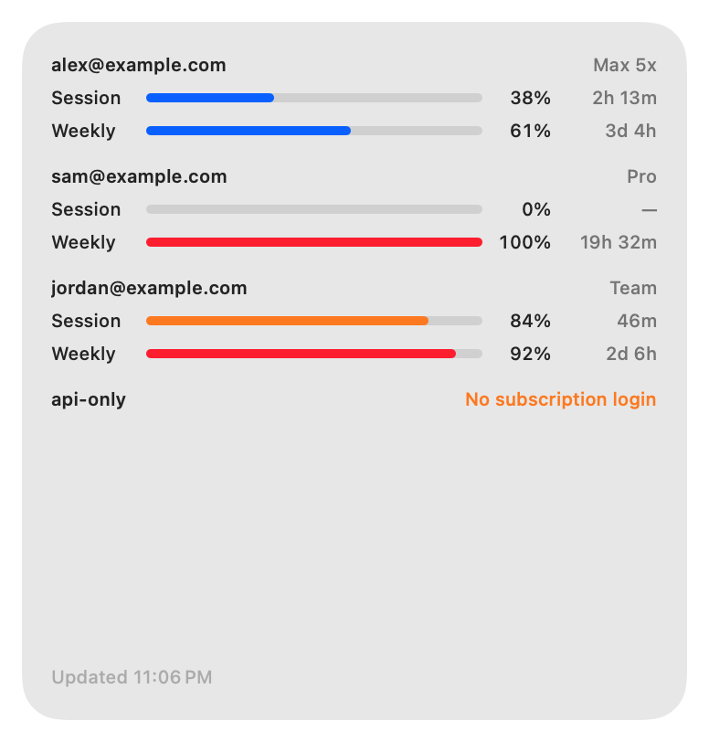

# Claude Profile Usage

**See the usage limits of all your Claude subscriptions at once.** A macOS menu bar app,
desktop widget and terminal command for people who run several Claude accounts side by side with
[`claude-profile`](#works-with-claude-profile).

For every account you get the email, the plan, how much of the **5-hour session** and the
**weekly** limit is used, and **when each one resets**.

<p align="center">
  
  &nbsp;
  
</p>

<p align="center">
  
  
</p>
<p align="center">
  
</p>

<sub>The widget designs are shared by the desktop widget and the WidgetKit widget. Screenshots use the built-in demo data (`CPU_DEMO=1`), so every name in them is fictional.</sub>

## Why

- **One glance instead of N logins.** Stop switching profiles and running `/usage` in each one to
  find out which account still has room.
- **Pick the right account before you start.** Sessions that haven't started, accounts at 90%+ and
  the next reset are all visible side by side, colour-coded (normal / warning / critical).
- **No new logins, no API keys.** It reuses the logins Claude Code already stored for each profile.
- **Always reachable.** Menu bar icon with your highest usage %, a Dock icon, a desktop widget,
  or a plain table in the terminal. A crowded menu bar can't hide it.
- **Private.** Talks only to Anthropic's own usage endpoint. No analytics, no third-party servers,
  tokens never written to disk, logs or output.

## Install

Requires macOS 14 (Sonoma) or newer and the Xcode Command Line Tools (Xcode itself is not needed).

```sh
xcode-select --install          # once, if you don't have the Command Line Tools
git clone https://github.com/shamsbd71/claude-profile-usage.git
cd claude-profile-usage
./scripts/install.sh
```

This builds everything, installs **`~/Applications/ClaudeProfileUsage.app`** and
**`~/.local/bin/claude-usage`**, and launches the app. Make sure `~/.local/bin` is on your `PATH`.

To start it automatically: System Settings → General → Login Items → **+** → *ClaudeProfileUsage*.

To remove it: `./scripts/uninstall.sh` (your Claude logins are not touched).

## Usage

### Menu bar

Click the gauge icon. The panel lists every profile with its limits and refreshes every
5 minutes; **⟳** refreshes now. The **⚙** menu has:

| Item | What it does |
|---|---|
| Refresh expired tokens | On by default. See [How it authenticates](#how-it-authenticates). |
| Show in Dock | On by default. Click the Dock icon to open the panel as a window. |
| Desktop widget / size | On by default. See [Desktop widget](#desktop-widget). |
| Open in Window | Shows the panel as a normal window. |
| Open Profiles Folder | Opens `~/.local/share/claude-profiles`. |

**Menu bar full?** macOS silently hides menu bar icons that don't fit, notably behind the notch.
macOS has no built-in way to reveal them. You can:

- **Click the Dock icon**, or launch the app again from Spotlight; both open the panel as a window.
- **Use the desktop widget**, which is always visible on the desktop.
- **Make room:** ⌘-drag icons to reorder them (icons on the left are hidden first), or turn off icons
  you don't need in System Settings → Menu Bar (Control Center on older macOS).
- **Use a menu bar manager** such as [Ice](https://github.com/jordanbaird/Ice) (free,
  `brew install --cask jordanbaird-ice`) or Bartender. They tuck extra icons behind a chevron you
  click to reveal.

### Desktop widget

A small, medium or large card that sits on your desktop wallpaper, below your windows, on every
Space. Drag it anywhere; it remembers its position. Right-click it to change the size, refresh, or
hide it. It updates live while the app runs.

There is also a WidgetKit widget (Edit Widgets → "Claude Profile Usage"). macOS's widget gallery
may not list widgets from apps signed locally without an Apple developer certificate, which is
how this project builds by default. That's why the desktop widget above exists.

### Terminal

```
$ claude-usage
PROFILE   EMAIL               PLAN    SESSION       WEEKLY          OTHER
work      alex@example.com    Max 5x  38% ↻ 2h 14m  61% ↻ 3d 5h     Opus 22%
personal  sam@example.com     Pro     –             100% ↻ 19h 33m
client    jordan@example.com  Team    84% ↻ 47m     92% ↻ 2d 7h
api-only  –                   —       no subscription login
```

`↻` is the time until that limit resets; `–` means the window hasn't started yet.

| Command | |
|---|---|
| `claude-usage` | table of all profiles |
| `claude-usage --watch` | live view, redraws every 60 s (`--watch 10` for every 10 s) |
| `claude-usage --json` | machine-readable output, e.g. `claude-usage --json \| jq '.[] \| {profile, status}'` |
| `claude-usage --no-refresh` | strictly read-only: never refresh an expired token |
| `claude-usage --demo` | fictional sample data, no Keychain access |

## Works with claude-profile

`claude-profile` keeps one Claude Code config directory per account, under
`~/.local/share/claude-profiles/<name>`:

```sh
claude-profile create work      # then log in:  claude-profile use work && claude
claude-profile create personal
claude-profile default work
```

Every directory there that holds a Claude subscription login shows up automatically. Profiles that use
an API key instead (no subscription) are listed as "No Claude subscription login". A plain
`~/.claude` login is shown too, unless its account already appears as a profile.

## How it authenticates

There's nothing to set up. When you log in to Claude Code inside a profile, it stores an OAuth login
in your macOS Keychain under `Claude Code-credentials-<first 8 hex chars of sha256(profile dir)>`.
This app reads that item with `/usr/bin/security`. Claude Code uses the same tool, so macOS doesn't
show a permission prompt.

With that token it calls `GET https://api.anthropic.com/api/oauth/usage`, the endpoint behind
Claude Code's `/usage` command.

**Expired tokens.** Access tokens last about 8 hours, so profiles you haven't used today will have
expired ones. With *Refresh expired tokens* on, the app renews them the same way Claude Code does:

1. It takes Claude Code's own refresh lock for that profile, so the two never refresh at once.
2. It re-reads the Keychain. If Claude Code already refreshed, it just uses that token.
3. Otherwise it refreshes and writes the new token back into the same Keychain item, changing only
   the token fields. Claude Code stays logged in.

It never recreates a login you've removed. If saving fails, it tells you and retries on the next
refresh.

Prefer strictly read-only? Turn the option off, or use `--no-refresh`. Expired profiles then show
"Token expired (refresh disabled)" until you use them in Claude Code again.

## Build from source

```sh
swift build                     # debug build of everything
swift test                      # unit tests (Swift Testing)
swift run claude-usage          # run the CLI from source
./scripts/bundle.sh             # dist/ClaudeProfileUsage.app (+ widget) and dist/claude-usage
CPU_DEMO=1 open dist/ClaudeProfileUsage.app            # try the app with demo data
CPU_DEMO=1 CPU_RENDER=docs/screenshots dist/ClaudeProfileUsage.app/Contents/MacOS/ClaudeProfileUsage  # regenerate screenshots
```

Layout:

| Path | |
|---|---|
| `Sources/UsageCore` | profile discovery, Keychain, token refresh, usage API, formatting |
| `Sources/ClaudeProfileUsage` | SwiftUI menu bar app |
| `Sources/ClaudeProfileUsageWidget` + `Sources/UsageWidgetViews` | WidgetKit extension and its views |
| `Sources/claude-usage` | terminal command |
| `scripts/` | bundle, install, uninstall, and `make-icon.sh` (regenerates `AppIcon.icns`) |

The app and the widget are ad-hoc signed locally; no Apple developer account is needed.

## Caveats

- Uses the same undocumented usage endpoint as Claude Code's `/usage`; if Anthropic changes it,
  this app needs an update.
- macOS only.
- Not affiliated with Anthropic.

## License

MIT
